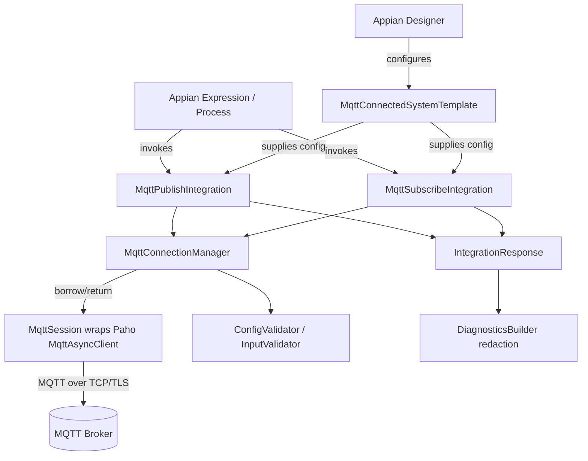
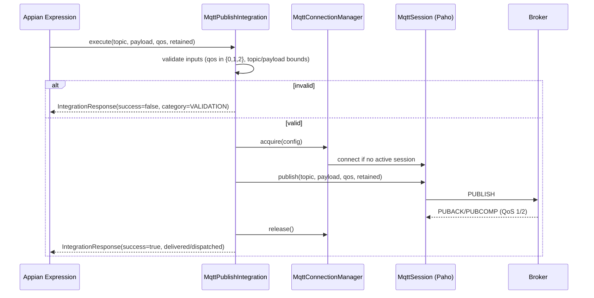
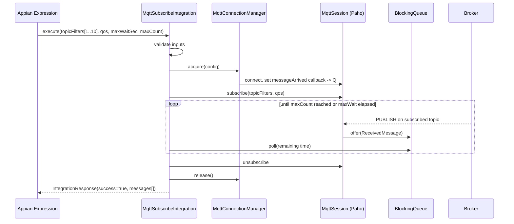

# Design Document

## Overview

This document describes the design of an Appian Connected System plug-in that lets Appian applications communicate with an MQTT broker. The plug-in packages one Connected System template (holding reusable connection, authentication, TLS, LWT, and session configuration) and two Integration templates (Publish and Subscribe) that execute operations against the configured broker.

The plug-in is built with the **Appian Connected System SDK** (Java, Corretto 17) and uses the **Eclipse Paho Java MQTT client** as the protocol-level client. The Connected System template defines the configuration surface through a `ConfigurationDescriptor`; sensitive fields (password, private key, keystore passphrase) are declared as encrypted/masked property types so they are never displayed after save or leaked to diagnostics. Each integration returns an `IntegrationResponse` carrying a success indicator, a result map, and diagnostics.

### Design decisions and rationale

- **Eclipse Paho (`org.eclipse.paho.client.mqttv3`)** is the standard, actively maintained JVM MQTT client. It directly supports every behavior the requirements need: TLS via a custom `SSLSocketFactory`, username/password, LWT (`setWill`), clean session, keep-alive, QoS 0/1/2, retained messages, and automatic reconnect. We build on it rather than implementing the MQTT wire protocol ourselves.
- **Synchronous request/response bridging for Subscribe.** Appian integrations are synchronous (invoke → return a result), but MQTT subscription delivery is event-driven. The Subscribe operation therefore uses a **bounded collection pattern**: it connects, subscribes, buffers inbound messages through a Paho callback into a thread-safe queue, and returns when either the max wait duration elapses or the max message count is reached (Requirement 6).
- **Connection reuse keyed by configuration.** A connection manager establishes a session on first use, reuses an active session for concurrent operations, and releases it when no active subscription still needs it (Requirement 4). This avoids reconnect overhead per operation while honoring lifecycle requirements.
- **Validation split into two layers.** Configuration-time validation runs in the Connected System / integration configuration descriptors so Designers get immediate feedback with values retained (Requirements 1, 2, 3, 7, 8). Runtime input validation (QoS, topic, payload bounds) runs inside each operation before any broker interaction (Requirements 5, 6).
- **Fixed error-category enum.** All failures map to a value from a closed, documented set so calling Appian expressions can branch on the category without parsing message text (Requirement 9).

## Architecture



### Layered responsibilities

1. **Configuration layer** — `MqttConnectedSystemTemplate` declares all reusable fields and validates them at design time. Produces an immutable `MqttConnectionConfig`.
2. **Operation layer** — `MqttPublishIntegration` and `MqttSubscribeIntegration` declare operation inputs, validate runtime inputs, invoke the connection manager, and assemble the `IntegrationResponse`.
3. **Protocol layer** — `MqttConnectionManager` and `MqttSession` translate `MqttConnectionConfig` into Paho `MqttConnectOptions`, manage the Paho client lifecycle, and perform publish/subscribe.
4. **Cross-cutting** — `MqttErrorCategory` (fixed enum), `DiagnosticsBuilder` (redaction), and validators are shared by all operations (Requirement 9).

### Request flows

**Publish (Requirement 5)**



**Subscribe — bounded collection (Requirement 6)**



## Components and Interfaces

### MqttConnectedSystemTemplate (Requirements 1, 2, 3, 7, 8)

Subclass of the SDK `SimpleConnectedSystemTemplate`. Implements `getConfiguration(...)` to declare fields and `validate(...)` for design-time validation that retains entered values.

Field groups declared in the `ConfigurationDescriptor`:

- **Connection** (Req 1): `brokerHost` (text, 1–253), `brokerPort` (integer), `clientIdentifier` (text, optional, 1–65535; auto-generated 1–23 chars when blank), `connectionTimeoutSeconds` (integer 1–300, default 30).
- **Authentication** (Req 2): `username` (text 1–256, optional), `password` (**encrypted/sensitive** 1–256, optional).
- **TLS** (Req 3): `tlsEnabled` (boolean), `caCertificate` (document/encoded text, optional), `clientCertificate` (document, optional), `clientPrivateKey` (**encrypted/sensitive**, optional), `keyPassphrase` (**encrypted/sensitive**, optional).
- **Reconnection** (Req 4): `autoReconnectEnabled` (boolean), `maxReconnectAttempts` (integer 0–10, default 3), `reconnectIntervalSeconds` (integer 1–120, default 5).
- **LWT** (Req 7): `lwtTopic` (text 1–65535, optional), `lwtPayload` (bytes/text 0–268435455, optional), `lwtQos` (choice 0/1/2), `lwtRetained` (boolean, default false).
- **Session** (Req 8): `cleanSession` (boolean, default true), `keepAliveSeconds` (integer 0–65535, default 60).

Interface:

```java
public class MqttConnectedSystemTemplate extends SimpleConnectedSystemTemplate {
    ConfigurationDescriptor getConfiguration(ConfigurationDescriptor descriptor,
                                             ConnectedSystemConfiguration config,
                                             ExecutionContext ctx);
    // design-time validation; returns errors mapped to specific fields, values retained
    ConfigurationDescriptor validate(...);
    static MqttConnectionConfig toConnectionConfig(ConnectedSystemConfiguration config);
}
```

Design-time validation rules (each rejects and retains values, Req 1.4/1.5/1.7, 2.4, 3.6, 7.4/7.5, 8.5/8.6):
- port outside 1–65535 → field error on port
- empty host → field error on host
- timeout empty/non-integer/outside 1–300 → field error on timeout
- exactly one of username/password set → "both or neither" error
- client certificate/key present but unloadable → certificate load error
- LWT payload set without LWT topic → missing-topic error; LWT QoS outside {0,1,2} or LWT topic > 65535 → invalid-field error
- clean session disabled with no client identifier → "client id required for persistent session" error
- keep-alive non-integer/negative/> 65535 → invalid keep-alive error

### MqttPublishIntegration (Requirement 5)

Subclass of `SimpleIntegrationTemplate` with a WRITE policy (it has side effects). Declares inputs `topic`, `payload`, `qos`, `retained`.

```java
public class MqttPublishIntegration extends SimpleIntegrationTemplate {
    IntegrationResponse execute(SimpleConfiguration integrationConfig,
                                SimpleConfiguration connectedSystemConfig,
                                ExecutionContext ctx);
}
```

Behavior: validate `qos ∈ {0,1,2}` (Req 5.3), topic non-empty / ≤ 65535 bytes / no wildcards (Req 5.4), payload ≤ 268435455 bytes (Req 5.1); on invalid input return VALIDATION without contacting the broker. On valid input, acquire a session, publish via Paho `MqttMessage` with QoS and retained flag (Req 5.2, 5.5), and return success — "delivered" after broker ack for QoS 1/2 (Req 5.6), "dispatched" for QoS 0 (Req 5.7). On missing ack within connection timeout for QoS 1/2, return DELIVERY_TIMEOUT (Req 5.8).

### MqttSubscribeIntegration (Requirement 6)

Subclass of `SimpleIntegrationTemplate`. Declares inputs `topicFilters` (list, 1–10), `qos`, `maxWaitSeconds` (1–300), `maxMessageCount` (1–1000).

Behavior: validate filter count (Req 6.8), each filter non-empty (Req 6.7), `qos ∈ {0,1,2}` (Req 6.9). On valid input, acquire a session, register a `messageArrived` callback that enqueues `ReceivedMessage` into a bounded `LinkedBlockingQueue`, subscribe at the requested QoS (Req 6.2), then drain the queue until `maxMessageCount` is reached or `maxWaitSeconds` elapses (Req 6.4, 6.5). Return collected messages — each with payload, originating topic, QoS, and retained indicator (Req 6.3); empty collection on timeout with no messages (Req 6.6); binary payloads returned Base64-encoded with a binary indicator (Req 6.10).

### MqttConnectionManager and MqttSession (Requirements 2, 3, 4, 7, 8)

```java
public class MqttConnectionManager {
    MqttSession acquire(MqttConnectionConfig config) throws MqttOperationException;
    void release(MqttSession session);
}

public class MqttSession {
    void publish(String topic, byte[] payload, int qos, boolean retained);
    void subscribe(List<String> filters, int qos, Consumer<ReceivedMessage> sink);
    void unsubscribe(List<String> filters);
    boolean isConnected();
}
```

`MqttSession` wraps a Paho `MqttAsyncClient`. `MqttConnectionManager.acquire` builds `MqttConnectOptions` from the config:

- `setUserName`/`setPassword` when both present; anonymous otherwise (Req 2.2, 2.3)
- `setSocketFactory(SSLSocketFactory)` built from CA cert + client cert/key, TLS ≥ 1.2, when `tlsEnabled` (Req 3.2, 3.3, 3.5); plain TCP otherwise (Req 3.7)
- `setConnectionTimeout(connectionTimeoutSeconds)` (Req 1.3, 4.2)
- `setWill(lwtTopic, lwtPayload, lwtQos, lwtRetained)` when LWT configured (Req 7.2); abort with LWT-registration error if the CONNECT exchange fails (Req 7.6)
- `setCleanSession(cleanSession)` (Req 8.1–8.3) and `setKeepAliveInterval(keepAliveSeconds)` (Req 8.4)
- `setAutomaticReconnect(autoReconnectEnabled)` with attempt/interval bounds enforced by the manager (Req 4.5); after exhausting attempts, surface a connection error indicating attempts exhausted (Req 4.6)

The manager caches an active session keyed by a connection fingerprint, hands the same session to concurrent operations (Req 4.1), and releases/closes it when no active subscription needs it (Req 4.3). A lost connection during an operation terminates the operation with a DISCONNECTION error naming host and port (Req 4.4).

### Cross-cutting: error categories and diagnostics (Requirement 9)

```java
public enum MqttErrorCategory {
    VALIDATION, AUTHENTICATION, CONNECTION_TIMEOUT, TLS_VALIDATION,
    DELIVERY_TIMEOUT, DISCONNECTION, CONFIGURATION, UNKNOWN;
}
```

`DiagnosticsBuilder` records broker host, operation name, outcome, and (on failure) error category into the Appian integration diagnostics (Req 9.3, 9.5), while a redaction step guarantees usernames, passwords, and private keys never appear in diagnostics, error message, or error category (Req 9.4). Every response carries a boolean success indicator (Req 9.1, 9.2); error messages are capped at 500 characters (Req 9.2); the category always comes from the fixed enum (Req 9.6).

## Data Models

```java
// Immutable configuration derived from the Connected System (Req 1,2,3,4,7,8)
record MqttConnectionConfig(
    String brokerHost, int brokerPort, String clientIdentifier,
    int connectionTimeoutSeconds,
    String username, char[] password,                 // sensitive
    boolean tlsEnabled, byte[] caCertificate,
    byte[] clientCertificate, char[] clientPrivateKey, // sensitive
    char[] keyPassphrase,                              // sensitive
    boolean autoReconnectEnabled, int maxReconnectAttempts, int reconnectIntervalSeconds,
    String lwtTopic, byte[] lwtPayload, int lwtQos, boolean lwtRetained,
    boolean cleanSession, int keepAliveSeconds
) {}

// Publish inputs (Req 5)
record PublishRequest(String topic, byte[] payload, int qos, boolean retained) {}

// Subscribe inputs (Req 6)
record SubscribeRequest(List<String> topicFilters, int qos,
                        int maxWaitSeconds, int maxMessageCount) {}

// A message delivered to a subscriber (Req 6.3, 6.10)
record ReceivedMessage(String topic, String payload, boolean binary,
                       int qos, boolean retained) {}

// Uniform operation result mapped into IntegrationResponse (Req 9)
record OperationResult(boolean success, MqttErrorCategory category,
                       String message, Map<String,Object> data) {}
```

Field bounds (enforced by validators):

| Field | Bound | Requirement |
|-------|-------|-------------|
| brokerHost | 1–253 chars, non-empty | 1.1, 1.5 |
| brokerPort | 1–65535 | 1.1, 1.4 |
| clientIdentifier | 1–65535 (auto 1–23 when blank) | 1.1, 1.2 |
| connectionTimeoutSeconds | 1–300, default 30 | 1.3, 1.7 |
| username / password | 1–256 each, both-or-neither | 2.1, 2.4 |
| maxReconnectAttempts | 0–10, default 3 | 4.5 |
| reconnectIntervalSeconds | 1–120, default 5 | 4.5 |
| publish topic | 1–65535 bytes, no wildcards | 5.1, 5.4 |
| publish payload | 0–268435455 bytes | 5.1 |
| qos (publish/subscribe) | 0, 1, or 2 | 5.3, 6.9 |
| topicFilters | 1–10 filters, each non-empty | 6.1, 6.7, 6.8 |
| maxWaitSeconds | 1–300 | 6.4 |
| maxMessageCount | 1–1000 | 6.4 |
| lwtTopic | 1–65535 chars | 7.1, 7.5 |
| lwtPayload | 0–268435455 bytes | 7.1 |
| lwtQos | 0, 1, or 2 | 7.1, 7.5 |
| keepAliveSeconds | 0–65535, default 60 | 8.4, 8.6 |
| error message | ≤ 500 chars | 9.2 |

## Correctness Properties

*A property is a characteristic or behavior that should hold true across all valid executions of a system — essentially, a formal statement about what the system should do. Properties serve as the bridge between human-readable specifications and machine-verifiable correctness guarantees.*

These properties cover the pure validation, configuration-mapping, and transformation logic of the plug-in. Behaviors that depend on a live broker, a real TLS handshake, or wall-clock timing (e.g. Req 2.5/2.6/2.7, 3.2/3.3/3.4, 4.2/4.6, 5.8, 7.3/7.6) are verified by integration tests instead and are listed in the Testing Strategy.

### Property 1: Connection field bounds validation

*For any* combination of broker host, port, client identifier, and connection timeout values, the configuration is accepted if and only if the host is non-blank and 1–253 characters, the port is 1–65535, the client identifier (when provided) is 1–65535 characters, and the timeout is an integer 1–300; otherwise the configuration is rejected, a validation message identifies the offending field, and the entered values are retained.

**Validates: Requirements 1.1, 1.3, 1.4, 1.5, 1.7**

### Property 2: Client identifier auto-generation bounds and stability

*For any* broker host and port with a blank client identifier, the generated client identifier is 1–23 characters, and the same host and port combination yields a client identifier that is distinct from that generated for any different host and port combination.

**Validates: Requirements 1.2**

### Property 3: Credential field validation (both-or-neither)

*For any* username and password pair, the configuration is accepted if and only if both are present and each is 1–256 characters, or both are absent; any single-sided or over-length combination is rejected with values retained.

**Validates: Requirements 2.1, 2.4**

### Property 4: Credential-to-connect-options mapping

*For any* connection configuration, the built connect options present username and password to the broker when both are configured, and request an anonymous connection (no credentials set) when neither is configured.

**Validates: Requirements 2.2, 2.3**

### Property 5: Certificate load validation

*For any* client certificate and private key byte input, loading succeeds when the input is a well-formed certificate/key pair and fails with a certificate-load error for any malformed input, and the configuration is rejected on failure.

**Validates: Requirements 3.6**

### Property 6: Reconnection bounds validation

*For any* reconnection configuration, the maximum attempts value is accepted if and only if it is an integer 0–10 and the reconnection interval is accepted if and only if it is an integer 1–120; absent values default to 3 attempts and 5 seconds respectively.

**Validates: Requirements 4.5**

### Property 7: Active session reuse

*For any* sequence of concurrent operation invocations that share the same connection configuration while a session is active, the connection manager hands out the same single session instance rather than establishing a new one.

**Validates: Requirements 4.1**

### Property 8: Session release when idle

*For any* operation sequence that ends with no active subscription requiring the connection, the connection manager closes the session and releases its network resources.

**Validates: Requirements 4.3**

### Property 9: Publish input validation

*For any* publish request, the request is accepted if and only if the topic is 1–65535 bytes with no wildcard characters, the payload is 0–268435455 bytes, and the QoS is 0, 1, or 2; otherwise the request is rejected with a VALIDATION error and no message is published.

**Validates: Requirements 5.1, 5.3, 5.4**

### Property 10: Publish message propagation

*For any* valid publish request, the message handed to the MQTT client carries the same topic, payload, QoS level, and retained flag as the request inputs.

**Validates: Requirements 5.2, 5.5**

### Property 11: Subscribe filter and QoS validation

*For any* subscribe request, the request is accepted if and only if it contains 1–10 topic filters, every filter is non-blank, and the QoS is 0, 1, or 2; otherwise the request is rejected with a VALIDATION error identifying the invalid filter, filter count, or QoS value.

**Validates: Requirements 6.1, 6.7, 6.8, 6.9**

### Property 12: Subscription registration propagation

*For any* valid subscribe request, the MQTT client is asked to register exactly the provided topic filters at the requested QoS level.

**Validates: Requirements 6.2**

### Property 13: Received message field preservation

*For any* message delivered on a subscribed topic, the returned record preserves the originating topic, payload, QoS level, and retained indicator of the source message.

**Validates: Requirements 6.3**

### Property 14: Subscribe collection bounds validation

*For any* subscribe request, the maximum wait duration is accepted if and only if it is 1–300 seconds and the maximum message count is accepted if and only if it is 1–1000.

**Validates: Requirements 6.4**

### Property 15: Bounded subscribe termination

*For any* stream of inbound messages and any valid maximum wait duration and maximum message count, the subscribe operation returns no more messages than the maximum count, returns no later than the maximum wait duration, and returns a successful empty collection when no messages arrive before the wait elapses.

**Validates: Requirements 6.5, 6.6**

### Property 16: Binary payload Base64 round-trip

*For any* binary message payload, the subscribe operation returns the payload as a Base64-encoded string together with a binary indicator set to true, such that Base64-decoding the returned string reproduces the original payload bytes exactly.

**Validates: Requirements 6.10**

### Property 17: LWT configuration validation

*For any* Last Will and Testament configuration, it is accepted if and only if, when an LWT payload is provided an LWT topic is also provided, the LWT topic is 1–65535 characters, the LWT payload is 0–268435455 bytes, and the LWT QoS is 0, 1, or 2; otherwise the configuration is rejected with a message identifying the invalid or missing field and its permitted range, and the entered values are retained.

**Validates: Requirements 7.1, 7.4, 7.5**

### Property 18: LWT-to-connect-options mapping

*For any* configuration with an LWT topic and payload, the built connect options register a will whose topic, payload, QoS level, and retained flag equal the configured values.

**Validates: Requirements 7.2**

### Property 19: Clean-session options mapping

*For any* connection configuration, the built connect options set the clean-session flag equal to the configured value (defaulting to enabled when unspecified), so a disabled clean session requests retained broker session state and an enabled clean session requests discarding prior state.

**Validates: Requirements 8.1, 8.2, 8.3**

### Property 20: Persistent-session requires client identifier

*For any* configuration with the clean session disabled and no client identifier, the configuration is rejected with an error indicating a client identifier is required for a persistent session, and the entered values are retained.

**Validates: Requirements 8.5**

### Property 21: Keep-alive bounds validation

*For any* keep-alive value, the configuration is accepted if and only if the value is an integer 0–65535; a non-integer, negative, or larger value is rejected with a validation error, and an absent value defaults to 60.

**Validates: Requirements 8.4, 8.6**

### Property 22: Response shaping and bounded error category

*For any* operation result, the mapped integration response sets the success indicator to true for a success and to false for a failure, and every failure carries an error category drawn from the fixed documented category set together with a textual error message of at most 500 characters.

**Validates: Requirements 9.1, 9.2, 9.6**

### Property 23: Diagnostics content

*For any* executed operation, the integration diagnostics record the broker host, the operation name, and the operation outcome, and additionally record the error category whenever the operation fails.

**Validates: Requirements 9.3, 9.5**

### Property 24: Sensitive value redaction

*For any* configuration containing a username, password, or private key, none of those exact sensitive values ever appears in the diagnostic output, the returned error message, or the returned error category of any operation.

**Validates: Requirements 9.4**

## Error Handling

All failures are expressed through the uniform `OperationResult` → `IntegrationResponse` path so Appian expressions can branch deterministically.

- **Error category enum (Req 9.2, 9.6).** Every failure is mapped to exactly one `MqttErrorCategory`: `VALIDATION`, `AUTHENTICATION`, `CONNECTION_TIMEOUT`, `TLS_VALIDATION`, `DELIVERY_TIMEOUT`, `DISCONNECTION`, `CONFIGURATION`, or `UNKNOWN`. Paho exceptions are translated to categories at a single mapping point (e.g. `MqttSecurityException` → `AUTHENTICATION`; TLS/`SSLHandshakeException` → `TLS_VALIDATION`; connect timeout → `CONNECTION_TIMEOUT`; lost connection → `DISCONNECTION`; missing publish ack → `DELIVERY_TIMEOUT`). An unrecognized exception maps to `UNKNOWN` rather than leaking an unclassified error.
- **Validation errors (Req 1, 2, 3.6, 5.3, 5.4, 6.7–6.9, 7, 8).** Design-time configuration validation returns field-scoped errors and retains entered values. Runtime input validation (QoS, topic, payload, filters) rejects before any broker interaction and returns `VALIDATION`.
- **Connection and delivery errors (Req 4.2, 4.4, 4.6, 5.8).** Connection-timeout, lost-connection, reconnect-exhausted, and delivery-timeout errors name the broker host and port in the message and set the matching category.
- **TLS errors (Req 3.4).** On server-certificate validation failure the connection attempt is terminated before any credentials or payload are transmitted, and `TLS_VALIDATION` is returned.
- **LWT registration failure (Req 7.6).** If the CONNECT exchange fails to register the will, the connection attempt is aborted and a connection error indicating LWT-registration failure is returned.
- **Message length cap (Req 9.2).** Error messages are truncated to 500 characters at the mapping point.
- **Redaction (Req 9.4).** A redaction filter runs over every outgoing message and diagnostic entry so configured usernames, passwords, and private keys cannot appear in any output. Sensitive values are held in `char[]`/`byte[]` and cleared after use where practical.
- **Resource safety (Req 4.3).** Sessions are released in `finally` blocks; a failed operation still releases or closes its session so a failure cannot leak a connection.

## Testing Strategy

The feature combines pure validation/transformation logic (well suited to property-based testing) with broker-, TLS-, and timing-dependent behavior (suited to integration tests). We therefore use a dual approach.

### Property-based tests

- **Library:** jqwik (JUnit 5 property-based testing for the JVM). We do not implement property testing from scratch.
- **Coverage:** one property-based test per correctness property (Properties 1–24 above).
- **Iterations:** each property test runs a minimum of 100 generated cases.
- **Tagging:** each test is annotated with a comment in the form **Feature: mqtt-broker-connected-system, Property {number}: {property_text}**.
- **Isolation:** protocol-dependent properties (Properties 4, 7, 8, 10, 12, 13, 18, 19) run against a fake/mock MQTT client and a fake connection manager so logic is tested without a live broker. Pure validators (Properties 1, 2, 3, 5, 6, 9, 11, 14, 17, 20, 21, 22, 23, 24) and transformations (Properties 15, 16) run entirely in memory.
- **Generators:** custom generators produce boundary-rich inputs — strings at length 0, 1, 23, 253, 256, 65535, and 65536; integers around 0, 1, 2, 3, 300, 65535; byte arrays including empty and large payloads; topic strings with and without `+`/`#` wildcards; UTF-8 multi-byte strings; and secret values embedded into configs for the redaction property.

### Unit (example-based) tests

For specific scenarios not needing universal quantification:
- QoS 1/2 acknowledged publish returns a "delivered" result; QoS 0 returns "dispatched" (Req 5.6, 5.7).
- TLS-disabled configuration produces plain-TCP connect options (Req 3.7).
- Subscribe with no inbound messages returns a successful empty collection within the wait window (Req 6.6).
- Exception-to-category mapping for each Paho exception type (feeds Req 9.2/9.6).

### Smoke / configuration-descriptor tests

- Password, private key, and passphrase fields are declared as encrypted/sensitive property types and are not rendered after save (Req 1.6).
- TLS enable/disable option and client-certificate upload fields are present in the descriptor (Req 3.1, 3.5).

### Integration tests (live or embedded broker)

Run against an embedded broker (e.g. HiveMQ test container / Moquette) and, where TLS behavior is exercised, a broker configured with server and client certificates. These cover the behaviors that cannot be reduced to a pure property:
- Client-certificate presentation and credential acceptance/rejection and auth timeout (Req 2.5, 2.6, 2.7).
- TLS channel establishment at ≥ 1.2, CA validation of the server certificate, and termination on validation failure (Req 3.2, 3.3, 3.4).
- Connection timeout against a non-accepting broker, lost-connection handling, and reconnect-attempt exhaustion (Req 4.2, 4.4, 4.6).
- Publish delivery timeout when acknowledgments are withheld (Req 5.8).
- Broker publishing the LWT after an unexpected disconnect, and aborting on LWT registration failure (Req 7.3, 7.6).

Representative examples (1–3 per behavior) are sufficient for these because the behavior does not vary meaningfully with generated input and the cost per iteration is high.
